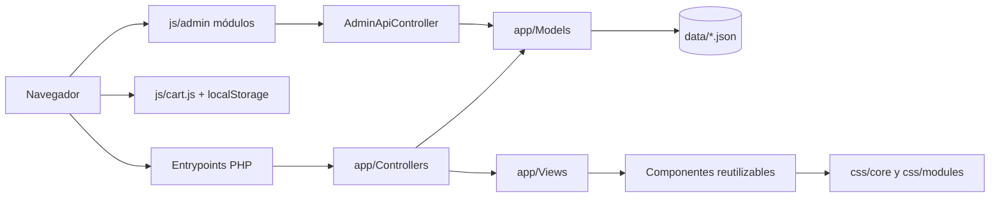

# Arquitectura MVC — Tambito

## Objetivo

Refactorizar el prototipo académico manteniendo las URLs existentes y sin incluir pagos reales. Se utiliza un MVC ligero en PHP 8.1+ sin framework, para facilitar el aprendizaje y evitar una migración innecesaria a otro stack.

## Diagrama



## Responsabilidades

| Capa | Carpeta | Función |
| --- | --- | --- |
| Entradas HTTP | `index.php`, `categorias.php`, `api/*.php` | Delegar a controladores; mantener enlaces antiguos |
| Controladores | `app/Controllers/` | Procesar solicitudes, seleccionar vistas, verificar permisos |
| Modelos | `app/Models/` | Leer y persistir documentos JSON de forma controlada |
| Plantillas | `app/Views/pages/` | Estructura HTML específica de cada pantalla |
| Layouts | `app/Views/layouts/` | HTML base público y administrativo |
| Componentes | `app/Views/components/` | Navegación, pie, formularios, productos y categorías |
| Diseño | `css/core/` + `css/modules/` | Tokens, reset, layout, componentes y reglas responsive |
| JavaScript | `js/cart.js`, `js/ui.js`, `js/admin/` | Carrito, menú, módulos administrativos y cliente HTTP |

### Ciclo de renderizado

1. El navegador abre una URL compatible (`index.php`, `productos.php` o `categorias.php`).
2. El archivo de entrada carga `app/bootstrap.php` (autoload para el namespace `Tambito`).
3. El controlador consulta los modelos, prepara datos y decide la vista.
4. `View::render` incorpora un layout y la plantilla de página.
5. La plantilla reutiliza componentes mediante `View::partial` y escapa contenidos con `View::escape`.
6. Las acciones del carrito se realizan solamente en el navegador; el panel administrativo consulta endpoints con sesión, permisos y CSRF.

### Reutilización

- **Product card**: utilizada en Inicio y Catálogo, con la misma estructura y estilos.
- **Category card**: utilizada para las categorías destacadas.
- **Section heading**: encabezados de secciones coherentes.
- **Site header/footer**: compartidos por todas las páginas públicas y de acceso.
- **Form field**: componente único en registro e inicio de sesión.
- **Admin API client**: añade token CSRF a solicitudes que modifican datos sin interceptar globalmente `fetch`.
- **ContentRepository**: lectura de catálogo con búsqueda y filtros desde una misma fuente.

## Estilos

`css/styles.css` es el único punto de entrada y carga módulos ordenados:

- `core/tokens.css`: paleta, tipografía, espaciado, radios, sombras y estados.
- `core/reset.css`: comportamiento básico, foco visible y reducción de movimiento.
- `modules/layout.css`: contenedores, navegación, footer.
- `modules/components.css`: botones, tarjetas, grids y componentes.
- `modules/pages.css`: composición específica de pantallas.
- `modules/forms.css`: formularios compartidos.
- `modules/responsive.css`: cambios en 1100, 900, 680 y 380 px.
- `modules/admin.css`: interfaz del panel aislada.

Las pantallas no cargan el conjunto histórico de reglas en cascada; se eliminaron hojas y scripts obsoletos. No se utilizan anchos fijos que excedan el viewport.

## Seguridad y alcance

El controlador de administración verifica el rol en servidor. Todas las escrituras a archivos JSON atraviesan `AdminApiController`, `EditableContentRepository` y las utilidades ya existentes en `security.php`. El registro/login continúan usando MySQL y hashes de contraseña.

El proyecto sigue siendo una **demostración académica, no tienda en producción**. No hay pagos, inventario real ni recuperación de contraseñas activa. Las imágenes y marcas no se licencian automáticamente.

## Estrategia de validación

```bash
php tests/smoke.php
php tests/mvc-smoke.php
node --test tests/cart.test.cjs
npm install
npx playwright install chromium
npm run test:ui
```

GitHub Actions ejecuta además sintaxis PHP/JS, comprobaciones HTTP y flujos temporales con MySQL. Playwright valida rutas y ausencia de desbordamiento horizontal en 360, 390, 768 y escritorio, junto con menú, carrito y filtros.

## Decisiones

- Mantener PHP puro y URLs anteriores para evitar una reescritura innecesaria.
- No introducir un framework o proceso de build para la interfaz principal.
- Conservar la separación entre catálogo JSON y cuentas MySQL.
- Usar estilos y componentes del proyecto; no copiar sistemas visuales externos.
- Documentar límites de pruebas y compatibilidad, sin atribuir seguridad de producción.
